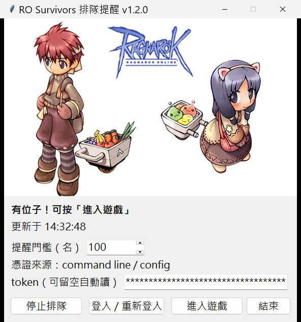
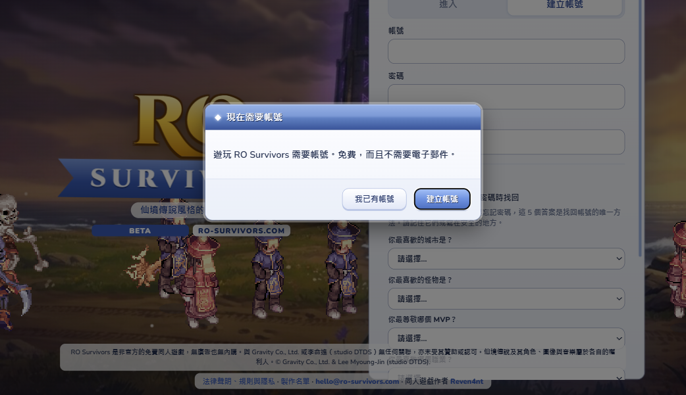

# RO Survivors 排隊提醒 — 圖文操作手冊

線上人數上限 20000 人，超過就要排隊。這支程式**幫你自動盯名次**：
不用開網頁、不用一直重新整理，名次排到你設定的門檻會**響三聲＋彈出提醒**，
按一下「進入遊戲」就直接開遊戲視窗。

免安裝：整個程式就一個 `ro-queue.exe`，不需要 Python。

## 1. 下載

到 [Releases 頁面](https://github.com/lono2023/ro-queue-reminder/releases/latest)
點 `ro-queue.exe` 下載，存到桌面或任何資料夾都可以。

## 2. 第一次開啟

1. 雙擊 `ro-queue.exe`。
2. 如果跳出藍色視窗「**Windows 已保護你的電腦**」：
   點「**其他資訊**」→ 再點「**仍要執行**」。
   （程式沒有買官方憑證簽章，Windows 才會這樣提示，不是病毒。）
3. 稍等一两秒，出現主介面：

   

> 工作管理員看到**兩個** `ro-queue.exe` 是正常的：單檔版有一個啟動程序加一個真正運行的程序。

## 3. 認識畫面（上圖由上而下）

| 位置 | 說明 |
| --- | --- |
| 狀態列（粗體那行） | 目前狀況：排隊中第幾名／**有位子！可按「進入遊戲」**／尚未登入… |
| 更新於 HH:MM:SS | 名次最後更新時間 |
| 提醒門檻（名） | 名次進到這個數字以內就響聲提醒，預設 100，可自行修改 |
| 憑證來源 | 顯示登入憑證從哪裡讀到的，正常不用管 |
| token 欄位 | 登入憑證，**留空即可**，程式會自動讀；特殊狀況才手動貼上 |
| 停止排隊 按鈕 | 不排了，讓出隊位（登入狀態保留） |
| 登入／重新登入 按鈕 | 開出遊戲登入視窗（見下一節） |
| 重貼 token 按鈕 | 手動重新讀取／貼上憑證 |
| 進入遊戲 按鈕 | 有位子時按它，開遊戲視窗準備進入 |
| 結束 按鈕 | 關閉程式（自動讓位） |

## 4. 登入（只做一次）

1. 按「**登入／重新登入**」。
2. 程式自動開出一個**專屬遊戲視窗**，裡面就是登入畫面：

   

3. 在**那個視窗裡**登入帳號（Google 或既有帳號皆可）。
4. 登入成功後**不用回程式按任何鍵**——程式會自動偵測到，狀態列變成「排隊中」或「有位子」。
5. 憑證會存進程式設定，之後每次開啟直接開始盯名次，不必再登入。

> 如果你的 Edge／Chrome 本來就已登入遊戲，程式會直接沿用那份登入憑證，連這一步都可跳過。

## 5. 排隊 → 提醒 → 進入遊戲

- 程式依間隔自動查名次（名次越近查越快，最快 5 秒一次），你可以去忙別的事。
- 名次進入門檻：**響三聲＋彈出提醒**，狀態列顯示「有位子！可按『進入遊戲』」。
- 按「**進入遊戲**」：
  - 專屬視窗還開著 → 直接切過去；
  - 已經關掉 → 自動再開一個，**隊位不會掉**。
- **遊戲請在程式開的那個視窗裡玩。**
  同一帳號在別處（別的瀏覽器、別的電腦）登入，線上會把這邊踢掉；
  被踢時程式會彈窗通知，按「登入／重新登入」重登即可。

## 6. 結束與讓位

- 「**停止排隊**」：不玩了、把隊位讓給別人（登入保留，之後还能再排）。
- 「**結束**」：關閉程式（會自動讓位）。
- 按視窗右上角 ✕ **不等於結束**——程式還在背景繼續排隊，請用「結束」關閉。

## 7. 常見問題

**Q1：彈窗說登入失效（401／被踢）？**
同一帳號在別處登入，線上把舊憑證踢掉了。按「登入／重新登入」重登，之後都在專屬視窗裡玩就不會再被踢。

**Q2：按「登入」後視窗沒出現？**
稍等幾秒（程式要啟動瀏覽器）。都沒動靜的話，自己用 Edge／Chrome 開
<https://ro-survivors.com/#playinnow-ro-zh-tw> 登入，再重開程式即可讀到憑證。

**Q3：狀態一直顯示「尚未登入」？**
还没登入過，或瀏覽器裡也沒有現成登入。照第 4 節登入一次。

**Q4：防毒把 exe 刪掉或封鎖？**
單檔、未簽章的程式偶爾被誤判。還原並加入信任清單即可。

**Q5：訪客帳號可以排嗎？**
訪客是直接進場、沒有名次可盯；請用註冊帳號（同一份憑證）才能接上排到的隊。

**Q6：設定和記錄存哪裡？**
`%APPDATA%\ro-queue\`（檔案總管位址列直接貼上即可）。刪掉整個資料夾就恢復預設。

## 8. 自動更新

啟動時會自動檢查新版，有新版本會提示並一鍵更新。
也可以手動下指令：`ro-queue.exe --update`（檢查）、`ro-queue.exe --install-update`（下載替換，下次啟動生效）。

---

進階用法（指令模式）請看 [README.md](README.md)。
